# AI Gateway 用户与管理员指南

先让一个账号接入一个模型或 MCP 工具，再按团队需要配置 Skill、知识库、共享文件和审批。本文按这个顺序介绍 Gateway 的实际使用。

> 适用对象：自行部署 AI Gateway 的开源用户、管理团队资源的管理员，以及负责 Agent 接入的成员。
>
> 文档更新：2026 年 11 月 12 日。界面依据当前 `1.0.25` 源码编写；这是文档对应的源码基准，不代表该版本产物已经发布。Gateway 与 ClaweeAgent 独立发布，联调时分别记录版本。
>
> 截图由当前管理台与用户中心使用虚构演示数据生成，地址、账号、模型和资源名称均为示例。功能是否显示取决于部署开关、模型模式与账号权限，不同用户看到的菜单可能不同。

## 目录

- [1. 先认识三个入口](#1-先认识三个入口)
- [2. 首次部署后的初始化](#2-首次部署后的初始化)
- [3. 用户中心：接入和授权](#3-用户中心接入和授权)
- [4. 配置模型服务](#4-配置模型服务)
- [5. 管理账号、角色与数据权限](#5-管理账号角色与数据权限)
- [6. 接入 MCP 工具](#6-接入-mcp-工具)
- [7. 发布 Skill、知识库和共享文件](#7-发布-skill知识库和共享文件)
- [8. 审批与工作流](#8-审批与工作流)
- [9. 客户端分发、更新和平台外观](#9-客户端分发更新和平台外观)
- [10. 巡检和常见问题](#10-巡检和常见问题)

## 1. 先认识三个入口

| 入口 | 谁使用 | 主要用途 |
| --- | --- | --- |
| ClaweeAgent 工作台 | 执行任务的成员 | 和 Agent 对话，处理项目文件，使用已授权工具和资源 |
| Gateway 用户中心 | 普通成员、Agent 负责人 | 查看我的 Agent、平台接入 Token、MCP 授权、审批和获权数据 |
| Gateway 管理后台 | 管理员 | 配置模型与工具、账号权限、团队资源、门禁和审计 |

AI Gateway 可以独立运行，服务 ClaweeAgent、其他 Agent、IDE 或企业应用。它负责接入与治理，实际文件处理和模型任务由所接入的 Agent 执行。

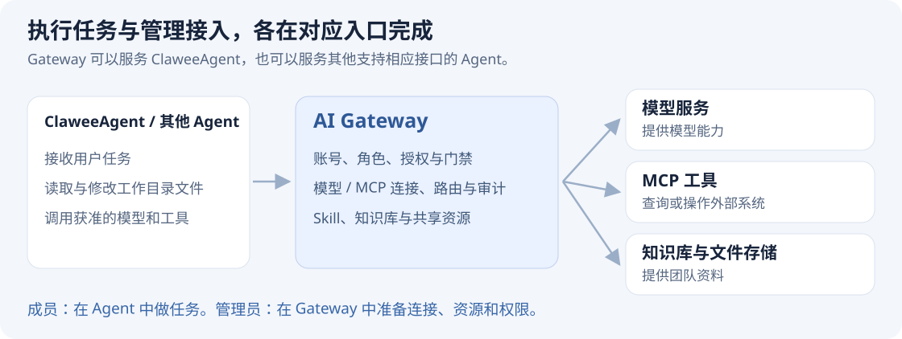

图 1：成员通过 Agent 使用获准能力；管理员在 Gateway 配置连接与权限。

只想使用 ClaweeAgent 完成任务，请阅读 [ClaweeAgent 用户指南](https://github.com/krillinai/ClaweeAgent/blob/main/docs/delivery/user-guides/Clawee用户指南.md)。本文不要求普通成员执行部署命令。

## 2. 首次部署后的初始化

### 2.1 部署入口

| 你的目标 | 对应文档 |
| --- | --- |
| 本机源码启动或 Docker Compose 体验 | [快速开始](../../zh-CN/README.md#快速开始) |
| 正式部署、HTTPS、持久化和备份 | [生产部署指南](../../../server/docs/deployment/production.md) |
| 了解配置字段与环境变量 | [配置参考](../../../server/docs/getting-started/configuration.md) |
| 了解运行组件和日常运维 | [运维部署指南](../../operations/operations-guide.md) |

真实配置、数据库连接串和密钥保存在源码仓库之外，初始化方法以对应部署文档为准。不要把文档示例中的占位地址当成可用服务。

### 2.2 注册第一个管理员

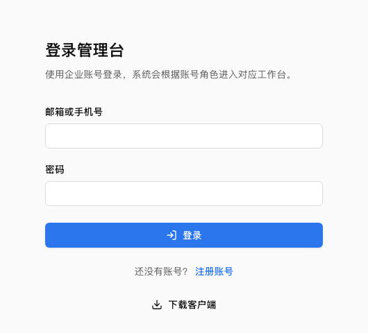

图 2：使用浏览器访问你部署的 Gateway，注册或登录；客户端可从同一页面下载。

1. 完成部署，确认 Gateway、数据库和管理台可以正常访问。
2. 在受控网络中打开 Gateway 地址，点击“注册账号”。**系统中的首个注册账号自动成为管理员。**
3. 使用自己的邮箱或手机号、名称和密码注册，再登录。
4. 确认可以进入管理后台，再创建其他成员或为后续注册账号配置权限。
5. 正式开放使用前，确认对外地址和 HTTPS 配置正确。

**完成标志：** 管理员可以进入后台，普通成员可以登录用户中心。没有团队资源或业务数据并不表示初始化失败。

### 2.3 最小可用配置顺序

1. **选定模型模式。** 企业自有模型由客户端配置；平台托管模型由 Gateway 管理员配置，见第 4 章。
2. **完成一个 Agent 接入。** ClaweeAgent 填写当前 Gateway 地址并登录；其他 Agent 使用其支持的模型或 MCP 配置方式。
3. **做一次简单调用。** 先验证普通问答或只读查询，确认身份、模型或工具可用。
4. **按需增加资源。** 再配置 Skill、知识库、网盘、业务数据和审批。
5. **用普通账号验证。** 管理员能看到资源不代表成员也能使用。

钉钉、业务看板、知识库服务、计费和反馈等集成需要额外配置。开源部署不自动附带客户的账号、技能包、知识文档、数据源或充值服务。

## 3. 用户中心：接入和授权

### 3.1 我的 Agent

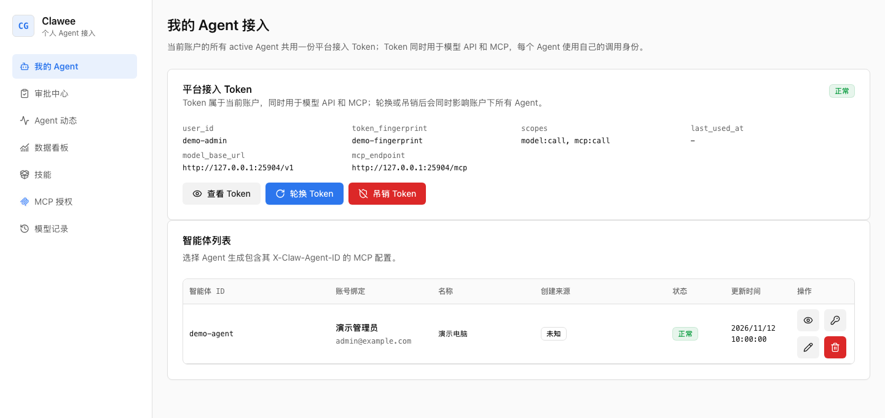

图 3：左侧选择功能，中间查看平台接入 Token 状态及当前账号下的 Agent。截图不包含可用令牌。

进入用户中心后点击“我的 Agent”。页面展示当前账号的平台接入 Token 信息、模型 Base URL、MCP 地址及 Agent 列表。

| 操作 | 用途和影响 |
| --- | --- |
| 查看 Token / 生成 Token | 为自己管理的可信 Agent 准备接入凭据；以页面实际状态和按钮为准 |
| 轮换 Token | 换发账号级凭据，旧令牌失效，影响该账号下所有使用旧令牌的 Agent |
| 吊销 Token | 停止该账号对应令牌的调用，依赖它的模型与 MCP 连接可能同时中断 |
| 查看授权 | 核对 Agent 可调用的能力与有效期 |
| 编辑名称 | 修改显示名称，不改变稳定 Agent 身份 |
| 删除 Agent | 移除不用的记录，先停用相关设备、任务和接入配置 |

平台接入 Token 同时用于模型与 MCP，分别需要 `model:call` 与 `mcp:call` scope。它与供应商的上游 API Key、网页登录密码用途不同，不要混填。

Agent MCP 配置可能包含 `X-Claw-Agent-ID`。从页面选择目标 Agent 后复制对应配置，保留它的调用身份，不要让不同设备随意复用同一个 Agent ID。

**完成标志：** Agent 出现在正确账号名下，连接到自己的 Gateway，最小调用成功。

### 3.2 MCP 授权

点击“MCP 授权”查看当前账号可访问的企业工具。先阅读工具说明，再让 Agent 发起所需调用。

目录可见、工具已开启、Agent 已授权和门禁已通过是不同条件。调用被拒绝时记录 Tool 名称、时间和错误提示，由管理员检查授权与审计。

### 3.3 审批中心

“审批中心”显示当前用户可以处理的 Skill 和工作流审批。打开待办后检查材料、版本或节点结果，再批准或拒绝。没有待办时列表为空是正常情况。

MCP 门禁和设备上的本地命令确认使用其他入口，区别见第 8 章。

### 3.4 Agent 动态、数据看板与技能

| 页面 | 可以做什么 | 出现条件 |
| --- | --- | --- |
| Agent 动态 | 按时间范围查看获权团队的使用统计和活动 | 有相应数据视图授权，且数据链路可用 |
| 数据看板 | 查看获权业务视图，切换账号和周期 | 已获权；实际数据还需要配置数据源并同步 |
| 技能 | 查看获权空间中的 Skill 和版本信息 | 技能空间授权与发布状态允许访问 |
| 模型记录 | 查看个人模型调用与用量 | 平台托管模型模式下显示，企业自有模型模式隐藏 |

小红书、抖音、哔哩哔哩等视图按实际集成情况使用。出现业务标签不代表已经接入数据，也不代表已具备自动发布或投放能力。

用户中心左下角提供主题、下载客户端、账户操作以及有权限时的“管理后台”入口。切换到后台后，按后续管理员章节操作。

## 4. 配置模型服务

### 4.1 先决定由谁管理模型

| 模式 | 配置位置 | 成员体验 |
| --- | --- | --- |
| `enterprise_managed`，默认 | ClaweeAgent 的“AI模型配置” | 填写自己的 Base URL、API Key 和模型名 |
| `platform_managed` | Gateway 的“模型网关” | 使用平台提供的模型，客户端配置只读且不回显密钥 |

模式由部署负责人在仓库外的 `configs/config.yaml` 中设置，修改后重启 Gateway：

```yaml
model_access:
  mode: "platform_managed"
```

选择企业自有模型时，将值设为 `enterprise_managed`。环境变量对应 `CLAW_GATEWAY_MODEL_ACCESS_MODE`，完整规则见[配置参考](../../../server/docs/getting-started/configuration.md)。

### 4.2 平台托管：添加模型上游账号

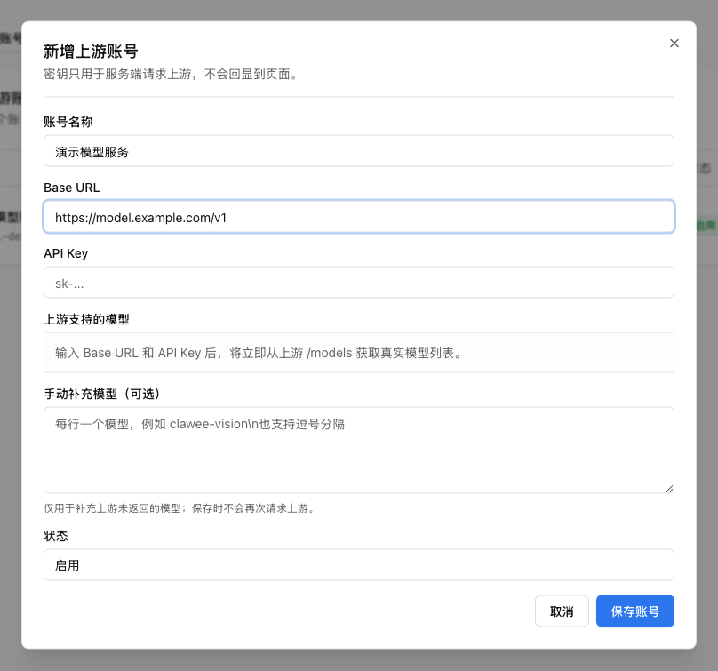

图 4：“模型网关 → 上游账号 → 新增上游账号”。这里填写的是模型供应商信息，不是成员的 Gateway 账号。

1. 点击“模型网关 → 上游账号 → 新增上游账号”。
2. 填写便于识别的账号名称、上游 Base URL 和供应商 API Key。
3. 查看获取到的模型目录；必要时使用“手动补充模型”，填写实际支持的模型名。
4. 保持需要使用的账号启用，点击“保存账号”。
5. 使用页面提供的测试操作验证连接，确认目标模型能够响应。

**完成标志：** 上游账号已启用，目录包含目标模型，测试有实际回复。列表出现模型名不等于该模型已经通过真实调用验证。

API Key 由 Gateway 服务端调用上游，不会回显到管理页。不要把它下发给全部成员，也不要将账号名称误认为模型名称。

### 4.3 建立模型组

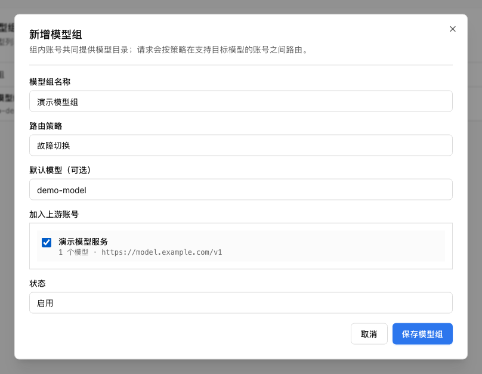

图 5：模型组将一个或多个上游账号组合起来，提供模型目录与调用路由。`demo-model` 是演示占位名称。

1. 进入“模型网关 → 模型组 → 新增模型组”。
2. 填写组名，选择已准备的上游账号。
3. 选择路由策略：
   - **故障切换：** 按配置选择能够提供目标模型的上游，失败时尝试其他可用账号。
   - **负载均衡：** 在能够提供目标模型的可用账号间轮询。
4. 按需要填写默认模型。留空表示跟随客户端请求；希望客户端省略模型时仍能调用，应配置可用默认模型。
5. 启用并保存，用目标成员账号做实际调用。

组内“账号”指模型上游账号，与普通成员账号及后台角色不同。

### 4.4 连接客户端并查看模型日志

| 配置项 | 示例 | 从哪里获得 |
| --- | --- | --- |
| Gateway Origin | `https://gateway.example.com` | 部署负责人提供，不包含额外路径 |
| 模型 Base URL | `https://gateway.example.com/v1` | 用户中心“我的 Agent” |
| API Key | 当前账号的平台接入 Token | 用户中心受控生成或查看 |
| 模型名称 | 实际可用的模型 ID | 管理员提供的模型目录 |
| MCP 地址 | `https://gateway.example.com/mcp` | 用户中心生成的配置 |

ClaweeAgent 通过登录接入 Gateway；平台托管模式下由现有接入流程提供模型配置。其他 Agent 或应用，按自身支持的 OpenAI 兼容 API 配置方式填写模型地址与平台 Token；代码和命令示例见 [模型 API 接入](../../zh-CN/README.md#模型-api)。

调用后进入“模型网关 → 全部日志”，检查时间、使用人、Agent、模型、状态、耗时及用量。用户可在“模型记录”中查看个人记录。

Token 统计只累计上游实际返回的已知用量。缺失或不完整用量会提示，不会补算历史缺失数据。模型费用、余额和充值依赖对应计费集成，不能仅凭启用模型网关就认为计费已配置完成。

**完成标志：** 成员实际调用成功，模型日志中能找到对应记录，使用人和模型均正确。

## 5. 管理账号、角色与数据权限

### 5.1 按这个顺序开通一个成员

1. 需要使用管理后台时，创建角色并勾选必要的后台功能权限；普通成员不必获得后台权限。
2. 创建账号或找到已注册账号，按需要分配角色。
3. 给成员配置具体资源的数据权限；技能空间也可通过角色继承权限。
4. 需要调用 MCP 时，再确认 Agent 的 Tool 授权和门禁策略。
5. 用目标账号重新登录，完成一次真实访问或调用。

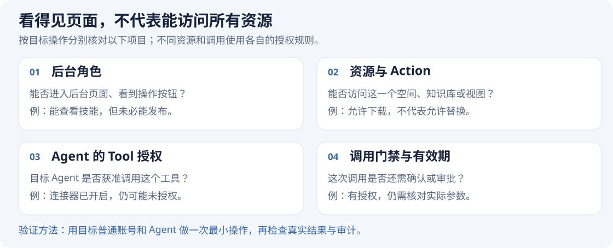

图 6：能打开页面、能访问某个资源、能执行某次调用，需要分别核对。

### 5.2 账号和角色

| 页面 | 常用操作 | 影响 |
| --- | --- | --- |
| 账号管理 | 新增账号、修改名称、重置密码、启用或禁用、合并 | 重置密码会使现有会话失效；禁用或合并前先检查任务与资源归属 |
| 角色管理 | 创建角色、选择权限、编辑或删除自定义角色 | 后台菜单和操作按钮按权限显示，系统角色一般只读 |
| 权限目录 | 查看权限名称、模块和操作范围 | 用于核对角色究竟获得了哪些后台能力 |

创建角色时填写名称并选择权限；内部编码由系统生成，创建后不可修改。批量选择某类全部权限前，先展开检查明细。

### 5.3 资源级授权

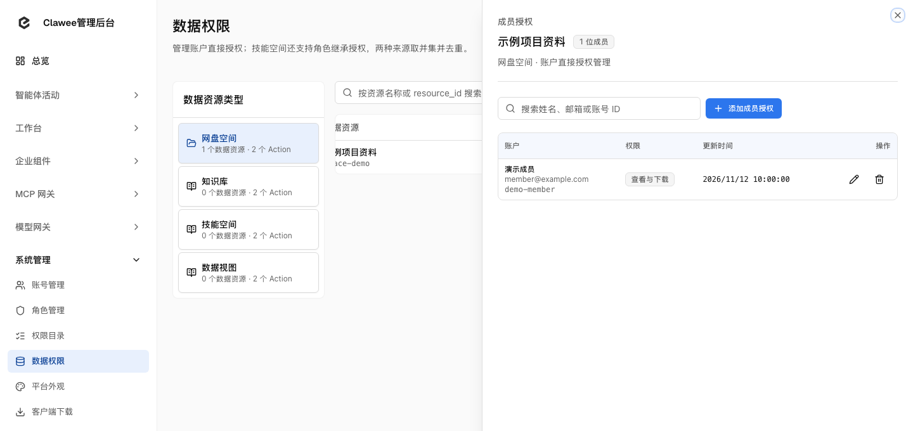

图 7：先选资源类型和具体资源，再查看成员授权；技能空间还支持角色授权。

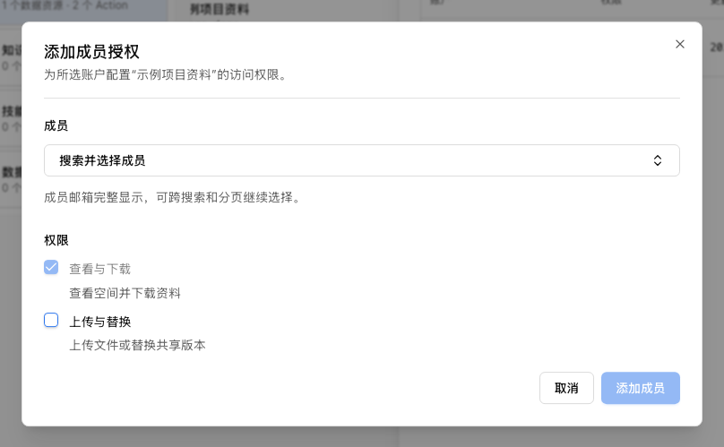

图 8：添加成员时选择访问动作。只需要下载资料的成员，不必同时获得上传或替换权限。

1. 进入“系统管理 → 数据权限”。
2. 选择网盘空间、知识库、技能空间或数据视图。
3. 找到具体资源，点击“管理授权”。
4. 添加目标成员并勾选所需 Action；技能空间可切换为按角色授权。
5. 保存，用目标账号验证。

例如“示例项目资料”空间中，查看与下载和上传与替换是不同动作。后台页面权限不能代替资源授权；授予某个资源也不代表可以管理所有同类资源。

**完成标志：** 目标成员能看到并执行所需动作，同时无法访问未授权的资源。

## 6. 接入 MCP 工具

### 6.1 配置上游服务

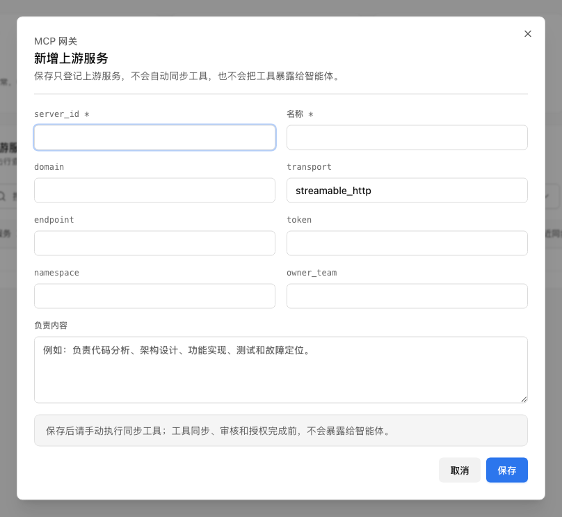

图 9：“MCP 网关 → 上游服务 → 新增上游服务”。传输方式、认证和地址由目标工具服务决定。

标准流程：

1. **登记上游。** 填写名称、传输方式、地址、命名空间、责任团队和必要认证信息。
2. **同步工具。** 从上游读取实际能力，检查同步结果和错误。
3. **审核能力。** 在能力目录核对名称、参数结构、风险和只读／破坏性标记。
4. **配置门禁。** 决定哪些调用需要用户确认或管理员审批。
5. **启用并授权。** 使目标能力可调用，为目标 Agent 或相应授权对象提供所需 Tool 权限。
6. **用目标身份测试。** 完成最小调用，并在代理审计中检查结果。

HTTP 上游填写对应 MCP 服务地址；`stdio` 会在运行 Gateway 的机器上启动命令，应由熟悉部署的人员配置。不要把成员电脑的程序路径直接当作服务器上的可执行路径。

详细配置示例见 [上游 MCP Server 接入](../../../server/docs/integration/upstream-mcp.md)。

### 6.2 能力目录与 Agent 授权

| 操作 | 注意事项 |
| --- | --- |
| 同步工具 | 更新目录，新增或变化的能力需要复核 |
| 启用 / 禁用能力 | 控制是否可调用，不自动补齐 Agent 授权 |
| 修改暴露名称 | 可能改变 Agent 调用入口，检查已有任务和技能依赖 |
| 设置门禁策略 | 确认审批人、风险和实际执行范围 |
| 添加 / 撤销 Tool 授权 | 限制 Agent 可用能力，并检查有效期 |
| 删除上游或缺失能力 | 先停用并处理授权及依赖，避免影响正在运行的任务 |

“智能体活动 → 智能体管理”用于查看和维护接入身份、责任账号及工具授权。按页面提供的创建、接入或绑定流程操作，保持每个 Agent 的稳定身份。

### 6.3 处理门禁并查看审计

1. 进入“MCP 网关 → 门禁队列”，筛选待处理调用。
2. 打开详情，核对 Tool、调用者、Agent、冻结参数、风险和有效期。
3. 允许执行时通过，不符合要求时拒绝并说明原因。
4. 执行后进入“代理审计”，核对真实结果。

**通过门禁会继续执行实际调用。** 不能只根据标题决定，也不能把通过理解为一次无副作用的预览。

“代理审计”可以按时间、Agent、上游、Tool、结果和错误筛选。调查问题时同时核对授权与门禁，不要仅看连接器是否已在客户端开启。

## 7. 发布 Skill、知识库和共享文件

### 7.1 企业 Skill

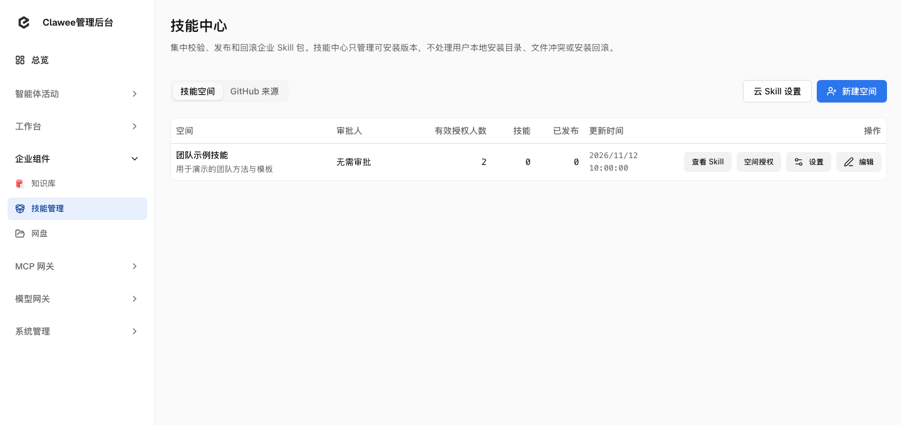

图 10：先在“技能空间”选择空间，再管理其中的技能和版本；“GitHub 来源”仅在部署启用后显示。新部署的空间列表可能为空。

从一份技能到成员可用，按以下顺序检查：

1. **建立技能空间。** 按团队或用途划分，配置成员或角色访问范围。
2. **打开目标空间，提交技能版本。** 使用 ZIP 上传，或在启用来源同步的部署中配置受信 GitHub 来源并同步。
3. **检查内容。** 核对来源、版本、说明、包摘要和所需工具。
4. **完成部署要求的评估与审批。** 成员上传可能进入 AI 评估及人工审批，查看对应报告和待办。
5. **发布到目标空间。** 上传或同步成功不等于已经发布。
6. **用成员账号安装并测试。** 确认技能可见、包校验通过、必要工具已获授权。

| 管理入口 | 主要用途 |
| --- | --- |
| 技能空间 | 建立空间，管理团队可访问的技能范围和成员 |
| 空间内的 Skill 列表 | 打开具体空间后查看详情和版本，上传、发布或调整空间 |
| GitHub 来源（按需启用） | 配置仓库、分支、扫描根和调度，同步后复核发现的版本 |
| 审批管理 / 审批中心 | 查看或处理相应审核请求，见第 8 章 |

首次评估或审批需要的评审 Agent、工具和外部服务由管理员另行准备。未配置时按页面提示处理，不应把“等待评估”解释为上传失败。

**完成标志：** 目标普通成员在 ClaweeAgent“企业Skill”中找到正确版本，安装并完成一次示例任务。

### 7.2 企业知识库

1. 由部署负责人配置百炼或 RAGFlow 提供方，见[知识库配置参考](../../../server/docs/getting-started/configuration.md)。
2. 进入“企业组件 → 知识库”，创建逻辑知识库，填写名称和说明。
3. 管理文档，上传或同步资料，等待解析和索引。
4. 配置成员的查看、上传和检索等实际所需权限。
5. 用成员账号从客户端检索一条已知内容，核对来源。

**完成标志：** 文档可用，成员真实检索能返回预期资料。只有页面和知识库名称，没有底层服务或索引时，仍不能完成问答。

### 7.3 共享文件与网盘

1. 进入“企业组件 → 网盘”，创建空间。
2. 先确认成员范围和权限，再上传文件。
3. 用普通账号验证下载；需要协作维护时，再授予写权限。
4. 更新资料时上传新版本，检查名称、版本及更新时间。

存储可使用本地目录或配置的阿里云 OSS，配置和备份由运维人员维护。共享文件不会自动同步到成员本机，成员需要从客户端保存到目标项目。

**完成标志：** 成员只能看到获权空间，并能将正确版本保存到自己的项目。

### 7.4 业务数据与 Agent 活动

- **业务数据：** 为相应视图准备真实数据源、业务账号和同步链路，再配置数据视图授权。以页面支持的账号管理和同步操作为准。
- **Agent 活动：** 检查所需采集或直报配置。平台托管模式的模型用量来自 Gateway 调用记录，任务活动和实时状态还取决于相应上报能力。
- **Skill 贡献：** 单独授予对应数据视图的权限，获权成员可从客户端工作台查看。

不要把未接入、未同步或未返回的数据记为零；排查时先读页面的数据状态和缺失项说明。

## 8. 审批与工作流

### 8.1 三种审批分别在哪里

| 类型 | 处理入口 | 影响 |
| --- | --- | --- |
| 客户端本地命令或文件操作确认 | ClaweeAgent 原会话 | 允许或拒绝本地操作 |
| MCP 调用门禁 | Gateway“MCP 网关 → 门禁队列” | 允许或拒绝具体的企业工具调用 |
| Skill 与工作流业务审批 | 个人“审批中心”；后台“工作台 → 审批管理”可查看管理记录 | 审核技能版本或流程节点 |

### 8.2 审批管理

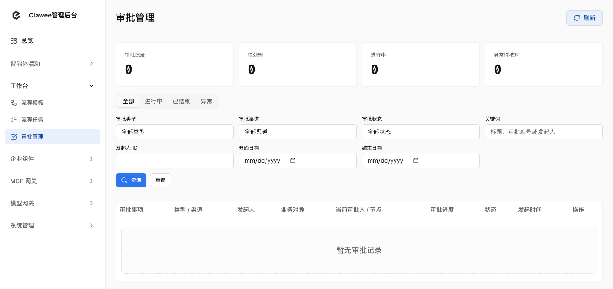

图 11：后台集中查看 Skill 审核及包含人工审批节点的工作流；空列表表示当前筛选下没有对应记录。

1. 进入“工作台 → 审批管理”，按类型、状态和关键词找到记录。
2. 查看材料、AI 评估、当前审批人及历史意见。
3. 当前账号是有效待审批人时，进入个人审批页处理。
4. 必须终止运行中的工作流时，填写原因并确认，再检查后续状态。

后台查看权限不等于审批资格。此页面不包含 MCP 门禁、客户端本地确认或纯 Agent 工作流，也不提供强制通过、批量审批等操作。详细规则见[审批管理](审批管理.md)。

钉钉审批需要另行配置。未配置钉钉时，可按已启用的本地审核机制使用，不必把所有审批都转入钉钉。

### 8.3 流程模板与流程任务

管理员在“工作台 → 流程模板”准备节点、执行关系和所需材料；“流程任务”查看已发起实例的状态、节点记录和正式结果。

上线一个模板后，使用普通账号发起一次测试：

1. 确认发起人可以选择模板。
2. 确认 Agent 节点能进入执行会话，并在检查结果后提交节点。
3. 确认人工节点只由有效审批人处理。
4. 确认流程详情中保留正式交付内容。

创建流程或批准节点不要求本机模型可用；需要 Agent 执行的节点，仍依赖承担执行的客户端、项目和模型。客户端的定时发起只创建流程任务和待办，不自动完成节点，离线时 Gateway 不接管客户端调度。

## 9. 客户端分发、更新和平台外观

### 9.1 配置下载入口

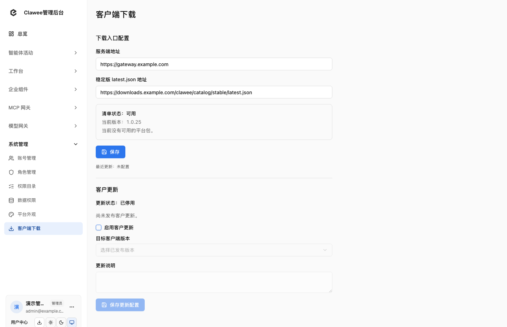

图 12：下载目录决定提供哪些安装包；更新配置决定成员客户端可以自动升级到哪个获准版本。截图中的版本和地址仅为演示。

1. 进入“系统管理 → 客户端下载”。
2. 配置对外 Gateway 地址和可信发布目录，检查安装包平台、版本和下载状态。
3. 保存，从未登录的浏览器打开 `/downloads` 验证。
4. 使用一台成员设备下载对应平台包，安装并连接当前 Gateway。

公开下载配置不应包含账号密码或带访问令牌的地址。没有某个平台安装包时，不应让成员下载其他架构的包替代。

### 9.2 批准自动更新版本

1. 在客户端下载管理页勾选“启用客户更新”。
2. 选择已经发布的目标版本，检查各平台包及不可用平台提示。
3. 填写更新说明，点击“保存更新配置”并确认。
4. 先在测试设备验证下载、校验、安装重启和数据保留，再扩大使用。

“客户更新”是页面上的部署级更新策略名称，开源自托管部署也使用这套机制。使用通用安装包连接自己的 Gateway，即可按本部署批准的版本更新。

客户端从本机配置的当前 HTTPS Gateway 读取获准版本，会自动检查、下载，并等待本地任务与编辑等条件满足后安装。退出登录不取消同一来源的已批准更新。HTTP 本机调试、不支持原生更新的运行方式以及缺少平台包等情况，需要按提示手动处理。

发布新的客户端版本不会自动改变本部署批准的目标版本。停用更新也不会回退已安装版本。

更新与各平台限制的详细说明见 [ClaweeAgent 更新机制](https://github.com/krillinai/ClaweeAgent/blob/main/client/apps/desktop/docs/customer-update.md)。

### 9.3 配置平台外观

进入“系统管理 → 平台外观”：

1. 分别选择浅色与深色模式，准备展开态 Logo 和折叠态图标。
2. 检查预览，按需要设置客户端品牌重点色，使用 `#RRGGBB` 格式。
3. 保存，在客户端切换主题检查效果。

未配置的 Logo 使用对应回退或默认图标。成员可以在客户端常规设置中选择个人重点色，点击“跟随品牌”恢复组织配色。菜单名称如经自定义，向成员说明它与本指南默认名称的对应关系。

## 10. 巡检和常见问题

### 10.1 管理员日常检查

- 在总览确认当前统计范围，检查接入状态、资源状态和治理待办。
- 在模型网关检查上游可用性和失败调用，区分缺失用量与真实零用量。
- 在 MCP 网关检查同步失败、工具变化、待处理门禁和代理错误。
- 对新增或变更的权限、资源和客户端版本，用目标普通账号或测试设备验证。
- 持久化目录和数据库按[生产部署指南](../../../server/docs/deployment/production.md)备份；不要把网页中能打开列表当作备份已完成。

### 10.2 常见问题

| 问题 | 排查顺序 |
| --- | --- |
| 找不到管理后台入口 | 当前账号是否有后台权限，是否登录了正确部署 |
| 新部署没有可用模型 | 当前模式是否为默认的企业自有模型；需要平台托管时，确认模式、上游和模型组均已配置 |
| 目标模型在目录里但不能调用 | 检查上游启用状态、真实调用结果、模型组成员与目标模型是否匹配，再看模型日志 |
| 轮换 Token 后多个 Agent 同时失败 | Token 属于账号级，更新所有依赖它的模型和 MCP 配置 |
| 用户可以打开页面但看不到资源 | 检查资源授权、Action、有效期、启用或发布状态，使用目标账号验证 |
| 连接器可见但工具被拒绝 | 检查上游、能力启用状态、Agent Tool 授权、门禁和代理审计 |
| Skill 上传后成员看不到 | 检查评估或审批进度、发布版本、目标空间和成员读取权限 |
| 知识文档长期处理中 | 检查提供方、解析和索引服务，不要重复上传同一文档规避错误 |
| 看板没有数据 | 检查数据视图授权、数据源和账号、首次同步及时间范围 |
| 动态统计缺失或客户端提示网关版本过旧 | 核对双方版本、对应统计或实时接口及上报配置；不要将缺失当作零 |
| 后台能看审批但不能批准 | 查看账号是否为当前有效审批人，后台查看权限不自动赋予审批资格 |
| 客户端一直没有自动更新 | 检查 HTTPS 当前服务器、启用状态、批准版本是否更高、目标平台包和客户端更新错误 |

### 10.3 反馈问题时准备什么

提供 Gateway 与客户端实际版本、发生时间、操作步骤、脱敏错误和对应日志或审计编号。不要公开密码、平台 Token、供应商 API Key、Cookie、真实客户文件或未经处理的截图。

涉及凭据泄露时，由负责人轮换或吊销对应凭据，再从调用审计核对影响。网页账号、平台 Token、上游密钥和外部系统凭据分别管理，更新其中一种不能替代其他凭据的处理。
